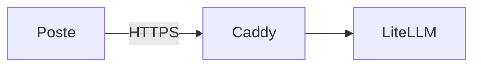

# Documentation de travail

Ici, on prend des notes, on écrit ses réflexions, on explique comment marche la plateforme et on dessine son architecture. Tout est en Markdown, les schémas en [Mermaid](https://mermaid.js.org/) : GitHub les affiche directement, et ils restent du texte que l'on modifie comme le reste.

Les guides d'installation et d'utilisation restent à la racine du dépôt ([GUIDE.md](../GUIDE.md), [SPARK-DUO.md](../SPARK-DUO.md)…). Ce dossier sert à **penser** la plateforme, pas à la faire tourner.

> ⚠ Ne pas confondre avec `docs-internes/` : ce dossier-là contient les **normes indexées par le RAG**. Rien de ce qui est ici n'y est indexé.

## Où mettre quoi

| Dossier | Pour quoi | Exemple |
|---|---|---|
| [architecture/](architecture/) | Schémas et explications de ce qui tourne, et comment ça se parle | [Vue d'ensemble de la stack](architecture/vue-ensemble.md), [architecture cible](architecture/cible-serveur-annexe.md) |
| [notes/](notes/) | Notes au fil de l'eau, datées : essais, mesures, constats | `2026-11-16-essai-qwen-duo.md` |
| [reflexions/](reflexions/) | Idées et pistes qu'on creuse, pas encore tranchées | `routage-auto-par-difficulte.md` |
| [decisions/](decisions/) | Choix tranchés, avec le pourquoi (une page par décision, numérotée) | [0001 : la doc vit dans le dépôt](decisions/0001-doc-dans-le-depot.md) |
| [processus/](processus/) | Comment on fait ce qui revient : étapes, ordre, livrables | [Benchmark et classement des modèles](processus/benchmark-modeles.md) |

Une réflexion qui aboutit devient une décision ; une décision qui change la stack met à jour un schéma de `architecture/`.

## Ajouter une page

1. Copier [_modele.md](_modele.md) dans le bon dossier.
2. Nommer le fichier en minuscules avec des tirets. Pour une note, commencer par la date : `AAAA-MM-JJ-sujet.md`. Pour une décision, par le numéro suivant : `0002-sujet.md`.
3. Ajouter une ligne dans le `README.md` du dossier.

On peut écrire directement depuis GitHub (bouton « Add file » puis « Create new file » dans le dossier), ou dans son éditeur puis faire un commit.

## Les schémas Mermaid en deux minutes

Un bloc de code marqué `mermaid` devient un schéma :

````markdown

````


Les types les plus utiles ici :

| Besoin | Type Mermaid |
|---|---|
| Qui parle à qui (services, machines) | `flowchart LR` avec des `subgraph` par machine |
| Déroulé d'une requête dans le temps | `sequenceDiagram` |
| États d'un service (arrêté, démarrage, prêt…) | `stateDiagram-v2` |
| Planning, jalons | `gantt` |

Pour essayer un schéma avant de le committer : [mermaid.live](https://mermaid.live). Si un libellé contient des parenthèses ou des deux-points, le mettre entre guillemets : `a["vLLM (tête Ray)"]`.
