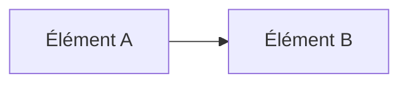

# Titre de la page

> **Date** : AAAA-MM-JJ · **Auteur** : prénom · **Statut** : brouillon | en cours | à jour | obsolète

## Contexte

Pourquoi cette page existe : la question, le constat ou le problème de départ.

## Contenu

Les notes, l'explication ou la réflexion elle-même. Un schéma si ça aide :

## Ce qu'on en retient

- Le point principal, en une phrase.
- La suite : action, question ouverte, ou décision à prendre (lien vers `decisions/` si elle est prise).

## Liens

- Issue, PR, page voisine, source externe.
