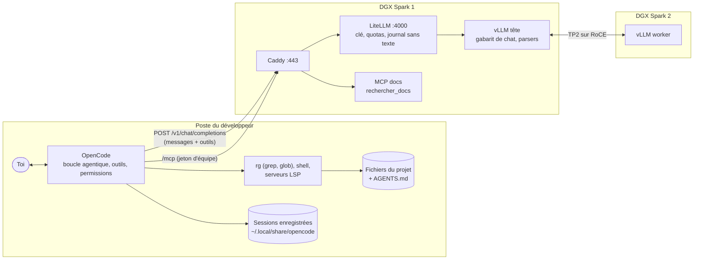
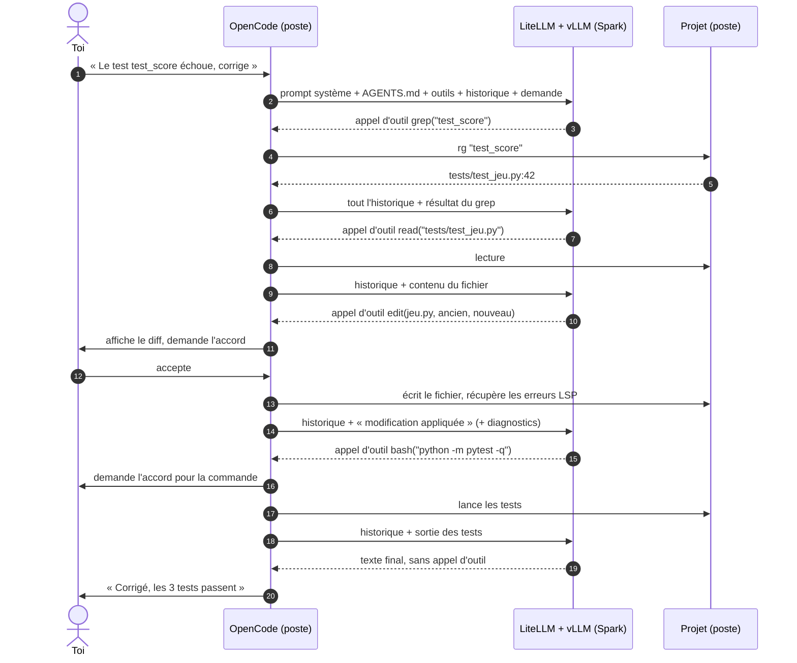

# Comment fonctionne l'agent de code OpenCode avec notre modèle

> **Date** : 2026-11-20 · **Auteur** : Antonin (rédigé avec Claude) · **Statut** : à jour (branche `spark-duo`, OpenCode 1.18.33, profil `qwen3.8-flash-next-nvfp4-duo`)

## Contexte

Quand on tape une demande dans OpenCode, qui décide de ce que le modèle voit ? Est-ce qu'on doit lui donner les fichiers, ou est-ce qu'il les trouve seul ? Comment sait-il lesquels ouvrir, et sous quelle forme arrivent-ils au modèle sur les Spark ? Cette page répond à ces questions, d'abord en général, puis pour notre installation (LiteLLM, vLLM en duo, Qwen3.8 Flash Next).

Les détails internes d'OpenCode (noms des outils, seuils de compaction) sont ceux des versions 1.x. Ils peuvent bouger d'une version à l'autre : pour la version exacte installée, la référence reste le code source d'OpenCode à l'étiquette `v1.18.33`.

## En une phrase

OpenCode est un programme **sur le poste** qui fait tourner une boucle : il envoie au modèle la conversation et la liste de ses outils, le modèle répond soit par du texte, soit par une **demande d'outil** (lire un fichier, chercher, lancer une commande…), OpenCode exécute cet outil **en local** et renvoie le résultat au modèle, et ainsi de suite jusqu'à ce que le modèle réponde sans demander d'outil. Le modèle ne voit jamais le disque : il ne voit que ce que les outils lui rapportent.

## Qui fait quoi



Ce qui compte :

- **L'intelligence est sur les Spark, l'action est sur le poste.** Le modèle décide quoi faire ; OpenCode le fait, sur ta machine, avec tes droits.
- **Rien n'est indexé à l'avance.** OpenCode ne construit pas de base vectorielle de ton code (contrairement à Cursor, par exemple). Il explore le projet à chaque session, comme un développeur qui arrive : il liste, cherche, ouvre. Seules les **normes internes** passent par une recherche vectorielle, via l'outil MCP `rechercher_docs`.
- **Le modèle est sans mémoire.** À chaque tour, OpenCode renvoie **toute** la conversation. La « mémoire » de la session, c'est l'historique qu'OpenCode garde sur le poste.

## 1. La boucle agentique



Chaque flèche vers LiteLLM est **une requête HTTP complète**. Une demande simple comme celle-ci fait facilement 5 à 15 requêtes au modèle ; une tâche plus large en fait des dizaines. C'est pour ça que la vitesse de **prefill** (lecture du contexte) compte autant que la vitesse de génération pour un agent.

La boucle s'arrête quand :

- le modèle répond par du texte sans appel d'outil (cas normal) ;
- tu refuses une permission ou tu interromps (`Échap`) ;
- une limite de pas est atteinte, si l'agent en a une ;
- OpenCode détecte que le modèle tourne en rond (le même appel d'outil répété à l'identique plusieurs fois de suite) et te demande quoi faire.

### Les deux agents principaux

`Tab` bascule entre deux « agents », qui sont le même modèle avec un prompt et des droits différents :

| Agent | Ce qu'il peut faire | Quand l'utiliser |
|---|---|---|
| **build** (par défaut) | Tous les outils : lire, chercher, modifier, lancer des commandes | Faire le travail |
| **plan** | Lire et chercher ; modifications et commandes refusées ou soumises à accord | Comprendre un code, préparer une approche avant de toucher aux fichiers |

L'agent principal peut aussi déléguer une sous-tâche à un **sous-agent** (outil `task`) : une conversation séparée, avec son propre contexte, qui ne renvoie qu'un résumé. Pratique pour une exploration large, parce que les dizaines de fichiers lus par le sous-agent ne remplissent pas le contexte de la conversation principale.

## 2. Le contexte : qui le fixe ?

Les deux. Une partie est **toujours envoyée**, une partie vient **de toi**, et le reste, souvent le plus gros, est **choisi par le modèle** au fil de la boucle.

| Origine | Ce qui est envoyé | Qui décide |
|---|---|---|
| **Toujours là** | Prompt système d'OpenCode (rôle, style, règles d'usage des outils), adapté à la famille du modèle | OpenCode |
| | Bloc d'environnement : dossier de travail, dépôt git ou non, système, date | OpenCode |
| | Consignes : `AGENTS.md` du projet (trouvé en remontant depuis le dossier courant), `~/.config/opencode/AGENTS.md` s'il existe, et la liste `instructions` de `opencode.json` | Toi, une fois pour toutes |
| | Description de chaque outil disponible (nom, quand s'en servir, paramètres en JSON Schema), y compris les outils MCP | OpenCode + `opencode.json` |
| **Toi, à chaque demande** | Ta demande | Toi |
| | Les fichiers cités avec `@chemin/du/fichier` : leur contenu est lu et joint d'office | Toi |
| | Les images collées, la sortie d'une commande lancée avec `!commande` | Toi |
| **Le modèle, au fil de la boucle** | Résultats de `list`, `glob`, `grep`, `read`, `bash`, `rechercher_docs`… | Le modèle |
| **Mémoire de la session** | Tout l'historique : demandes, réponses, appels d'outils et leurs résultats | Accumulé, puis élagué ou résumé (section 4) |

Donc : **tu n'es pas obligé de donner les fichiers**, l'agent sait les trouver. Mais lui donner les bons fichiers avec `@` lui fait gagner des tours (et du temps), et évite qu'il parte sur une mauvaise piste. Avec un modèle local, c'est souvent la différence entre une réponse en 20 secondes et une en 2 minutes.

## 3. Comment il sait quels fichiers prendre

Il ne le « sait » pas : il **cherche**, exactement comme toi dans un projet inconnu. Le choix vient du modèle, guidé par trois choses : ta demande, les descriptions des outils, et `AGENTS.md`.

### Les outils de lecture et de recherche

| Outil | Ce qu'il fait | Ce que le modèle reçoit |
|---|---|---|
| `list` | Liste un dossier (en ignorant `node_modules`, `.git`, `dist`…) | Une arborescence |
| `glob` | Trouve des fichiers par motif (`**/*.py`, `src/**/test_*.py`), via ripgrep | Une liste de chemins |
| `grep` | Cherche une expression régulière dans le contenu, via ripgrep | Les lignes trouvées avec chemin et numéro de ligne |
| `read` | Lit un fichier, par défaut jusqu'à 2 000 lignes, avec un décalage possible pour les gros fichiers | Le contenu avec les numéros de ligne |
| `bash` | N'importe quelle commande (`git log`, `tree`, `pytest`…) | La sortie, tronquée si elle est trop longue |
| `docs-internes_rechercher_docs` | Recherche dans les normes internes (serveur MCP sur le Spark) | Les extraits les plus pertinents, avec leur source |

ripgrep respecte le `.gitignore` : les fichiers ignorés par git sont aussi invisibles pour `grep` et `glob`. C'est en général ce qu'on veut (pas de `venv/`, pas de build), mais un fichier généré qu'on voudrait lui faire lire doit être cité explicitement.

### La démarche typique du modèle

1. **Repérer** : `list` ou `glob` pour voir la structure, ou directement `grep` sur un mot de la demande (nom de fonction, message d'erreur, nom de test).
2. **Lire** : `read` sur les deux ou trois fichiers trouvés, souvent seulement la partie utile d'un gros fichier.
3. **Élargir si besoin** : suivre un import, chercher les appelants d'une fonction avec `grep`.
4. **Modifier** : l'outil `edit` remplace un passage exact par un autre (il échoue si le passage n'existe pas, ce qui évite d'écraser à l'aveugle). `write` réécrit un fichier entier. OpenCode refuse de modifier un fichier que le modèle n'a pas lu, ou qui a changé depuis.
5. **Vérifier** : lancer les tests avec `bash`, lire la sortie, recommencer.

### Le rôle d'AGENTS.md

`AGENTS.md` est injecté dans le prompt système **à chaque requête**. C'est le meilleur endroit pour lui épargner l'exploration : où est le code, où sont les tests, quelle commande les lance, ce qu'il ne faut pas toucher. Notre modèle ([clients/AGENTS.md](../../clients/AGENTS.md)) contient déjà les règles générales ; c'est la partie « Ce projet » qu'il faut remplir pour chaque dépôt. Quelques lignes de carte du projet (« `src/api/` : routes FastAPI, `src/metier/` : règles de calcul ») évitent plusieurs tours de `list`/`grep` à chaque session.

Comme il est renvoyé à chaque requête, il faut le garder **court** : chaque ligne coûte des jetons à chaque tour.

### Le rôle du LSP

OpenCode démarre en arrière-plan les serveurs de langage (LSP) qu'il trouve pour les langages du projet (Pyright, typescript-language-server, gopls…). Il s'en sert surtout **après une modification** : les erreurs que le LSP signale sur le fichier modifié (import manquant, variable inconnue, erreur de type) sont ajoutées au résultat de l'outil `edit`/`write`. Le modèle voit donc tout de suite qu'il a cassé quelque chose, sans attendre les tests.

Chez nous, `OPENCODE_DISABLE_LSP_DOWNLOAD=1` (posé par `installer-opencode.sh`) empêche OpenCode de télécharger ces serveurs : seuls ceux **déjà installés** sur le poste servent. Pour en profiter en Python, installer Pyright sur le poste (`npm install -g pyright`).

## 4. Comment tout ça est transmis au modèle

### La requête

OpenCode parle à LiteLLM avec le protocole OpenAI (paquet `@ai-sdk/openai-compatible`). Chaque tour est un `POST https://spark1.lan/v1/chat/completions` en streaming, de cette forme (simplifiée) :

```json
{
  "model": "qwen-local",
  "stream": true,
  "max_tokens": 32768,
  "messages": [
    { "role": "system", "content": "Tu es opencode… <env> dossier, git, OS, date </env> … contenu d'AGENTS.md" },
    { "role": "user", "content": "Le test test_score échoue, corrige" },
    { "role": "assistant", "content": null,
      "tool_calls": [{ "id": "c1", "type": "function",
        "function": { "name": "grep", "arguments": "{\"pattern\":\"test_score\"}" } }] },
    { "role": "tool", "tool_call_id": "c1", "content": "tests/test_jeu.py:42: def test_score():" },
    { "role": "assistant", "content": null,
      "tool_calls": [{ "id": "c2", "type": "function",
        "function": { "name": "read", "arguments": "{\"filePath\":\"tests/test_jeu.py\"}" } }] },
    { "role": "tool", "tool_call_id": "c2", "content": "1\timport pytest\n2\tfrom jeu import verifier\n…" }
  ],
  "tools": [
    { "type": "function", "function": { "name": "read", "description": "Reads a file from the local filesystem…",
      "parameters": { "type": "object", "properties": { "filePath": { "type": "string" }, "offset": {}, "limit": {} } } } },
    { "type": "function", "function": { "name": "docs-internes_rechercher_docs", "description": "…", "parameters": {} } }
  ]
}
```

Les fichiers ne sont donc **pas envoyés à part** : un fichier lu devient le texte d'un message `tool`, au milieu de la conversation. Il y reste pour les tours suivants, jusqu'à ce qu'il soit élagué ou résumé.

### Ce que vLLM en fait

Le modèle ne comprend pas le JSON d'OpenAI : il ne lit que du texte. vLLM fait la traduction dans les deux sens.

1. **Aller : le gabarit de chat.** vLLM applique le gabarit (chat template) livré avec le modèle Qwen. Il transforme `messages` et `tools` en un seul long texte : les descriptions d'outils sont insérées dans le prompt système, chaque message est entouré de ses balises (`<|im_start|>user …`), les résultats d'outils sont placés dans des blocs `<tool_response>`.
2. **Le modèle génère** d'abord son raisonnement entre `<think>…</think>`, puis soit du texte, soit un appel d'outil au format XML de Qwen :
   ```
   <tool_call>
   <function=read>
   <parameter=filePath>tests/test_jeu.py</parameter>
   </function>
   </tool_call>
   ```
3. **Retour : les parsers.** `--reasoning-parser qwen3` sort le raisonnement dans un champ à part (`reasoning_content`), que l'interface d'OpenCode affiche comme « réflexion ». `--tool-call-parser qwen3_xml` (avec `--enable-auto-tool-choice`) reconnaît le bloc `<tool_call>` et le convertit en `tool_calls` JSON propres, avec `finish_reason: "tool_calls"`. C'est ce signal qui dit à OpenCode « exécute un outil et rappelle-moi ».

Si le parser ne correspond pas au format du modèle, l'agent est cassé de façon trompeuse : l'appel d'outil arrive comme du texte brut dans la réponse, OpenCode ne l'exécute pas, et la conversation s'arrête. C'est le premier suspect quand on change de modèle (voir les profils dans [config/modeles-spark/](../../config/modeles-spark/)).

LiteLLM, entre les deux, ne touche pas au contenu : il vérifie la clé, applique les quotas, enlève les paramètres que vLLM ne connaît pas (`drop_params: true`), coupe une requête au bout de 600 s, et écrit une ligne de journal **sans le texte** des prompts ni des réponses (`store_prompts_in_spend_logs: false`).

### Le cache de préfixe : pourquoi renvoyer tout l'historique ne coûte pas si cher

Comme chaque tour renvoie toute la conversation, le 10ᵉ tour d'une session peut faire 60 000 jetons, alors qu'il n'y a que 2 000 jetons nouveaux (le dernier résultat d'outil). Avec `--enable-prefix-caching` (dans notre profil), vLLM garde en mémoire le calcul déjà fait sur le début identique de la conversation et ne calcule que la fin nouvelle. C'est ce qui rend un agent utilisable sur un modèle local.

Ce cache se perd quand le début de la conversation change : après une compaction, après un changement d'`AGENTS.md` ou de modèle en cours de session, ou quand la mémoire de vLLM est prise par d'autres requêtes et que le cache est évincé. Le tour suivant relit alors tout le contexte, et il est nettement plus lent. Notre modèle étant hybride (couches Mamba + attention), la réutilisation du cache dépend aussi du support de vLLM pour ce type de modèle : à vérifier dans les journaux (« prefix cache hit rate ») lors des tests de charge.

### Les limites de contexte

| Réglage | Valeur | Où |
|---|---|---|
| Contexte max accepté par vLLM | 262 144 jetons | `VLLM_MAX_MODEL_LEN` dans le profil |
| Contexte connu d'OpenCode | 262 144 jetons | `limit.context` dans `opencode.json` (`--contexte` à l'installation) |
| Réponse max demandée par OpenCode | 32 768 jetons | `limit.output` dans `opencode.json` |
| Requêtes traitées en parallèle par vLLM | 8 | `VLLM_MAX_SEQS` |

Les deux premières valeurs **doivent être égales** (ou celle d'OpenCode plus petite). Si OpenCode croit avoir plus de place que vLLM n'en accepte, il n'élague pas à temps et vLLM refuse la requête avec une erreur « maximum context length ». Le script d'installation met 65 536 par défaut (valeur du PC de test) : sur les Spark, il faut passer `--contexte 262144`.

Le contexte utile pour l'historique est donc d'environ 262 144 − 32 768 ≈ 229 000 jetons. Au-delà, OpenCode réagit en deux temps :

1. **Élagage** : les vieux résultats d'outils (contenus de fichiers lus il y a longtemps, sorties de commandes) sont remplacés par une mention « contenu effacé », en gardant intacts les plus récents (de l'ordre des 40 000 derniers jetons de résultats). Les demandes et réponses restent.
2. **Compaction** : quand la conversation approche quand même de la limite, OpenCode demande au modèle d'en écrire un **résumé** (ce qui a été demandé, fait, décidé, les fichiers en jeu), puis repart de ce résumé. `/compact` déclenche la même chose à la main.

Après une compaction, l'agent a perdu le détail des fichiers lus : il les relira s'il en a besoin. C'est normal.

**262 144 jetons acceptés ne veut pas dire 8 sessions de 262 144 jetons en même temps.** Le cache KV de vLLM est partagé entre toutes les requêtes en cours, et notre profil n'en laisse qu'environ 10 à 16 Go par Spark. vLLM annonce au démarrage combien de requêtes de longueur maximale il peut tenir (ligne « Maximum concurrency for 262,144 tokens per request » dans ses journaux). Si plusieurs développeurs ont de longues sessions en même temps, vLLM met des requêtes en attente ou en interrompt pour les reprendre plus tard : les réponses ralentissent. Des sessions courtes et ciblées (une tâche, puis `/new`) aident tout le monde. C'est un des points à mesurer dans le [plan de tests de charge](../processus/plan-tests-charge.md).

## 5. Les réglages propres à notre installation

Tous viennent de [clients/opencode.json](../../clients/opencode.json) (copié dans `~/.config/opencode/opencode.json` par `installer-opencode.sh`), de [config/litellm.yaml](../../config/litellm.yaml) et du profil vLLM actif.

| Réglage | Valeur | Effet sur l'agent |
|---|---|---|
| `provider.local` | `@ai-sdk/openai-compatible`, `baseURL` = `https://spark1.lan/v1` | OpenCode parle à LiteLLM via Caddy comme à n'importe quelle API OpenAI |
| `apiKey` | `{env:LITELLM_API_KEY}` | Clé personnelle : chaque requête est attribuée à un développeur dans le journal LiteLLM |
| `model` | `local/qwen-local` | Le modèle de la boucle agentique |
| `small_model` | `local/qwen-local` | Le modèle des petites tâches (titre de la session, résumés). Même modèle : ces requêtes apparaissent aussi dans le journal LiteLLM |
| `mcp.docs-internes` | `https://spark1.lan/mcp`, jeton d'équipe | Ajoute l'outil `docs-internes_rechercher_docs` à la liste envoyée au modèle |
| `tools.docs-internes_*` | lister, lire, écrire, exécuter : désactivés | Le serveur MCP sait aussi manipuler des fichiers, mais ces outils sont retirés : l'agent passe par ses propres outils locaux, soumis aux permissions |
| `permission.edit` / `permission.bash` | `ask` | Chaque modification et chaque commande attend ton accord |
| `instructions` | `["AGENTS.md"]` | Consignes du projet injectées à chaque requête |
| `OPENCODE_DISABLE_*` | dans `~/.config/ia-locale/env` | Pas de mise à jour auto, pas de téléchargement de la liste des modèles ni des serveurs LSP : rien ne sort vers Internet |
| `--tool-call-parser` | `qwen3_xml` | Traduit les appels d'outils de Qwen en JSON OpenAI |
| `--reasoning-parser` | `qwen3` | Sépare la réflexion `<think>` de la réponse |
| `--enable-prefix-caching` | activé | Évite de recalculer l'historique à chaque tour |
| LiteLLM `request_timeout` | 600 s | Une requête (un tour de boucle) ne peut pas dépasser 10 minutes |

Côté confidentialité : le code lu par l'agent part sur le Spark (dans le réseau interne), est traité par vLLM, et n'est écrit nulle part côté serveur. L'historique complet des sessions, lui, est enregistré **sur le poste**, dans `~/.local/share/opencode/`.

## 6. Voir ce qui se passe réellement

- **Exporter une session** : `opencode export` (choisir la session) sort tout l'historique en JSON, y compris chaque appel d'outil et son résultat. C'est la façon la plus directe de voir ce que le modèle a reçu.
- **Journaux d'OpenCode** : `opencode --log-level DEBUG`, ou `opencode run --print-logs "…"` pour les voir dans le terminal. Les fichiers sont dans `~/.local/share/opencode/log/`.
- **Côté serveur** : le journal LiteLLM (une ligne par tour : durée, temps jusqu'au premier jeton, jetons en entrée et en sortie) permet de voir combien de tours une tâche a pris et comment le contexte a grossi. Les journaux de vLLM donnent le taux de réussite du cache de préfixe et l'occupation du cache KV.
- **Les recherches dans les normes** sont journalisées par le serveur MCP (voir [GUIDE.md](../../GUIDE.md), section 4).

## Ce qu'on en retient

- Le modèle **choisit** son contexte en appelant des outils ; OpenCode **exécute** ces outils sur le poste et renvoie les résultats. Il n'y a pas d'index du code : l'agent explore avec `grep`, `glob`, `read`.
- Toi, tu fixes le cadre (`AGENTS.md`, permissions) et tu peux raccourcir l'exploration avec `@fichier`. C'est le levier le plus efficace avec un modèle local.
- Tout passe par `/v1/chat/completions` : les fichiers lus sont du texte dans des messages `tool`, l'historique entier est renvoyé à chaque tour, le cache de préfixe de vLLM évite de tout recalculer.
- Le bon fonctionnement repose sur trois réglages à garder cohérents : le **parser d'outils** de vLLM (format du modèle), la **longueur de contexte** (vLLM = OpenCode), et le **cache de préfixe**.
- À mesurer : nombre de tours et taille de contexte par tâche type, taux de cache de préfixe, et concurrence réelle de sessions longues sur le duo.

## Liens

- [GUIDE.md](../../GUIDE.md), section 4 : installer et utiliser OpenCode.
- [Vue d'ensemble de la stack](vue-ensemble.md).
- [clients/opencode.json](../../clients/opencode.json), [clients/AGENTS.md](../../clients/AGENTS.md), [scripts/installer-opencode.sh](../../scripts/installer-opencode.sh).
- Profil vLLM : [config/modeles-spark/qwen3.8-flash-next-nvfp4-duo.env](../../config/modeles-spark/qwen3.8-flash-next-nvfp4-duo.env).
- Documentation OpenCode : [opencode.ai/docs](https://opencode.ai/docs) (outils, agents, règles, LSP, configuration).
