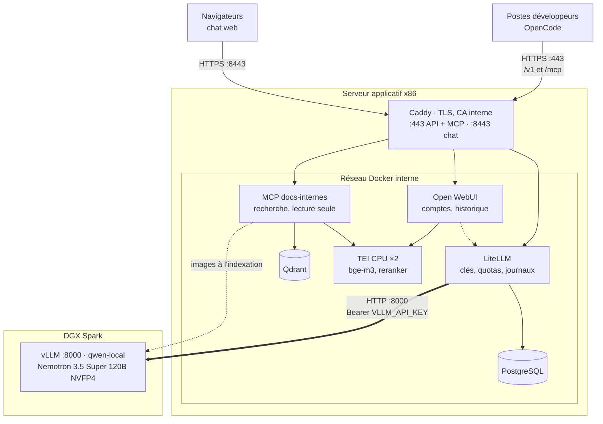

# Architecture cible : serveur applicatif + DGX Spark

> **Date** : 2026-11-16 · **Statut** : architecture **cible**, pas encore déployée
>
> ⚠ Ce n'est pas la stack qui tourne aujourd'hui. Aujourd'hui, tout tourne sur le Spark 1 (et le modèle est réparti sur deux Spark) : voir [vue-ensemble.md](vue-ensemble.md). Cette page décrit la cible avec un **serveur annexe** x86 qui porte tout sauf le modèle (`docker-compose.serveur.yml`, non testé).
>
> Version mise en page (HTML, en anglais) : [plateforme-cible.html](plateforme-cible.html). GitHub affiche le code source d'un fichier HTML : pour la voir, la télécharger (bouton « Download raw file ») et l'ouvrir dans un navigateur.

## En une phrase

Une plateforme d'IA auto-hébergée (agent de code, recherche dans les normes internes par RAG, chat web) en **deux étages** : un serveur applicatif x86 pour l'accès, les applications et les données, et un NVIDIA DGX Spark réservé à l'inférence. Tout est déployé avec Docker Compose et tourne hors ligne une fois les modèles téléchargés.

## Schéma

Le tout reste dans le réseau interne : aucun accès Internet n'est nécessaire en fonctionnement. Les versions, ports et rôles de chaque brique sont dans les tableaux ci-dessous.

## Flux réseau

| Source | Destination | Port | Protocole | Authentification |
|---|---|---|---|---|
| Postes (OpenCode) | Serveur · Caddy | 443 | HTTPS `/v1` | Clé LiteLLM personnelle (`sk-…`), révocable |
| Postes (OpenCode) | Serveur · Caddy | 443 | HTTPS `/mcp` | Jeton Bearer d'équipe |
| Navigateurs | Serveur · Caddy | 8443 | HTTPS | Compte Open WebUI |
| Serveur · LiteLLM, MCP | DGX Spark · vLLM | 8000 | HTTP | Clé API Bearer, plus une règle de pare-feu sur l'IP source |
| Serveur · Prometheus | DGX Spark · exporteurs GPU et machine | 9835, 9100 | HTTP | Aucune : seule la règle de pare-feu sur l'IP source les protège |
| Admins | Les deux machines | 22 | SSH | Clés SSH |

Tous les autres ports sont liés à localhost ou au réseau Docker interne. Le trafic serveur → Spark reste dans le réseau local, en HTTP simple ; il peut passer en TLS si la politique de sécurité l'exige.

## Composants

| Composant | Machine | Image / version | Rôle | Données persistantes |
|---|---|---|---|---|
| Caddy | Serveur | `caddy:2.10.2` | Terminaison TLS, routage, CA interne | certificats |
| LiteLLM | Serveur | `litellm:v1.98.1` | Passerelle API, clés par utilisateur, quotas, routage | dans Postgres |
| PostgreSQL | Serveur | `postgres:16-alpine` | Base de LiteLLM | clés, consommation |
| Open WebUI | Serveur | `open-webui:v0.11.4` | Chat web | comptes, conversations |
| MCP docs-internes | Serveur | maison (Python) | Outil de recherche dans les normes, ingestion PDF/Word | documents sources |
| Qdrant | Serveur | `qdrant:v1.19.2` | Index vectoriel | embeddings |
| TEI ×2 | Serveur | `text-embeddings-inference:cpu-1.9` | Embeddings (bge-m3), reranking (bge-reranker-v2-m3) | fichiers des modèles |
| vLLM | Spark | vLLM 0.30 (arm64) | Inférence du LLM | poids du modèle, cache de compilation |

## Sécurité

- Deux ports exposés sur le serveur (443, 8443). Depuis l'IP du serveur, le Spark n'accepte que le port 8000 (vLLM) et les ports 9835 et 9100 (métriques GPU et machine lues par Prometheus), plus SSH. En duo, le Spark 2 n'ouvre au serveur que 9835 et 9100. Les règles ufw sont dans `SERVEUR-ANNEXE.md`, section 4.
- Une clé API par utilisateur, avec quotas et suivi de consommation. Révoquer une clé coupe immédiatement l'accès de la personne.
- Le serveur MCP n'offre que la recherche documentaire en lecture seule. Aucun outil fichier ou shell n'est joignable depuis le réseau.
- Les secrets (clé maître, mot de passe de la base, jetons) sont dans un fichier `.env` en mode 600, jamais commité.

## Exploitation

- Fonctionne entièrement hors ligne (`HF_HUB_OFFLINE=1`). Internet ne sert qu'à récupérer les images et les poids des modèles, qui peuvent aussi arriver par un disque de transfert.
- Toutes les données persistantes sont dans un seul dossier de données par machine : une sauvegarde, c'est un dossier.
- On change de modèle par un profil dans `config/modeles-spark/`. Les clients gardent le même nom de modèle.
- Supervision : Prometheus sur le serveur (port 9090, localhost) collecte les métriques de vLLM et des exporteurs des Spark. Le panneau de contrôle (port 7000, localhost ou tunnel SSH) tourne aussi sur le serveur, avec un script de vérification.

## Montée en charge de l'inférence

| Étape | Réseau | Ce que ça permet |
|---|---|---|
| **1 Spark** | aucun | Un modèle jusqu'à ~100 Go, 8 requêtes simultanées |
| **2 Spark** | câble QSFP direct, 200 Gb/s | Soit un modèle réparti sur les deux (vLLM + Ray, tensor parallel 2, NCCL sur RoCE), soit deux réplicas répartis par LiteLLM |
| **4 Spark** | switch 200 GbE (RoCE) | Un modèle réparti plus gros, ou 2 à 4 réplicas derrière LiteLLM |

Le serveur applicatif, les points d'accès et la configuration des clients restent les mêmes à chaque étape : seule la liste des backends d'inférence de LiteLLM change.

## Écarts avec la stack actuelle

| | Aujourd'hui ([vue-ensemble.md](vue-ensemble.md)) | Cible (cette page) |
|---|---|---|
| Services applicatifs | Sur le Spark 1, à côté de vLLM | Sur un serveur x86 dédié |
| Embeddings et reranker | vLLM en mode pooling, sur le GPU du Spark | TEI sur le CPU du serveur |
| Modèle | Réparti sur deux Spark (duo) | Un Spark, puis 2 ou 4 selon le tableau ci-dessus |
| Mémoire GPU pour vLLM | `VLLM_GPU_UTIL` 0.68 en duo, 0.74 sur un Spark | ≈ 0.85, le Spark ne fait plus que le modèle |
| Configuration | `docker-compose.spark.yml` + `docker-compose.spark-duo.yml` | `docker-compose.serveur.yml` (non testé) |
