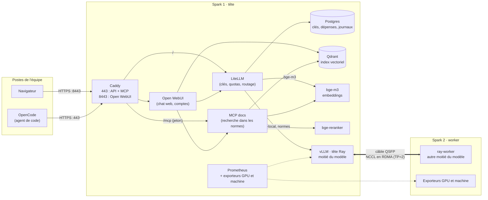
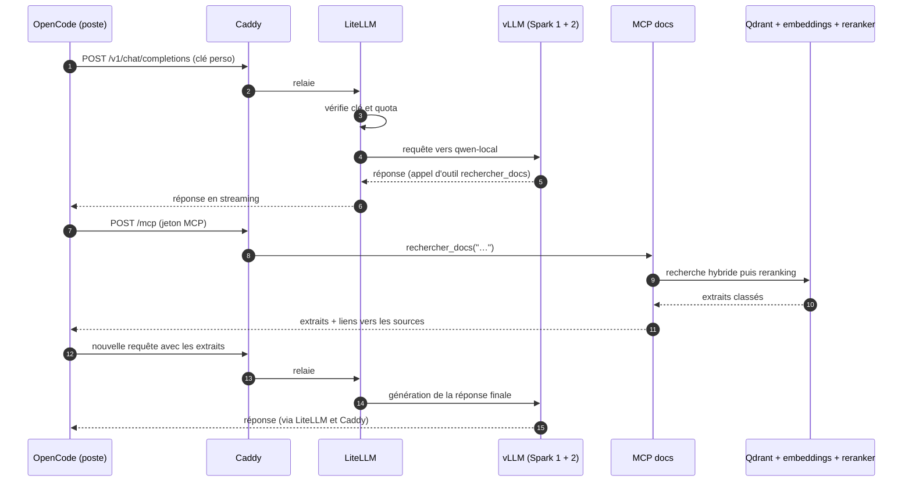
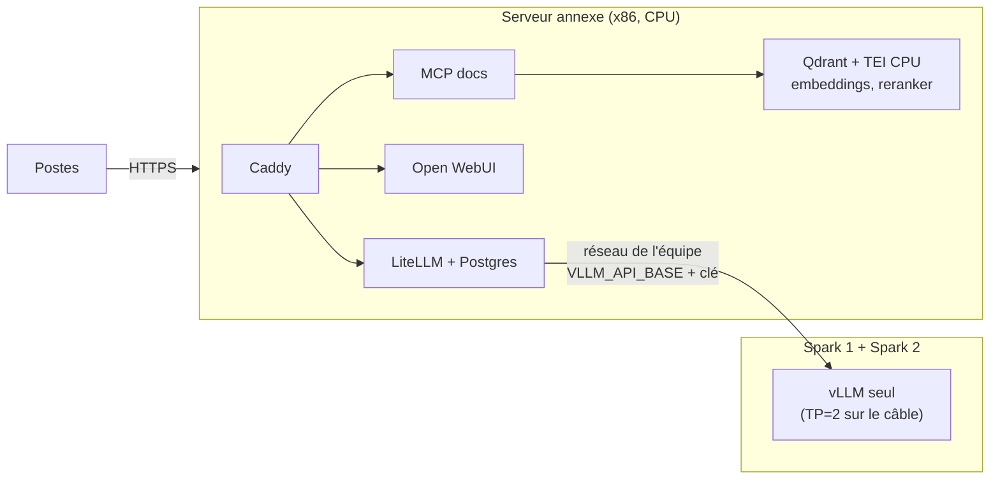

# Vue d'ensemble de la stack

> **Date** : 2026-11-16 · **Statut** : à jour (branche `spark-duo`)

## En une phrase

Les postes parlent à **Caddy** en HTTPS sur le Spark 1. Caddy envoie le chat et l'agent de code vers **LiteLLM** (clés, quotas, journal), qui appelle le modèle servi par **vLLM**, réparti sur les deux Spark reliés par un câble QSFP. La recherche dans les normes passe par le serveur **MCP docs** (Qdrant + embeddings + reranker).

## Machines et services

| Brique | Rôle | Où regarder |
|---|---|---|
| Caddy | Seule porte ouverte sur le réseau, HTTPS avec certificat interne | `config/Caddyfile.spark` |
| Open WebUI | Chat web avec comptes utilisateurs, outils MCP | `docker-compose.yml`, `services/open-webui/` |
| LiteLLM | API compatible OpenAI pour tous les clients : une clé par personne, quotas, journal des requêtes | `config/litellm.yaml` |
| Postgres | Base de LiteLLM | `docker-compose.yml` |
| MCP docs | Outil `rechercher_docs` : recherche hybride + reranking dans `docs-internes/` | `services/mcp-docs/` |
| Qdrant | Index vectoriel des normes | `docker-compose.yml` |
| bge-m3, bge-reranker | Embeddings et reranker, servis par vLLM en mode pooling sur le GPU (TEI n'existe pas en ARM64) | `docker-compose.spark.yml` |
| vLLM | Le modèle (profil actif dans `config/modeles-spark/`), réparti en tensor parallel sur les deux Spark avec Ray | `docker-compose.spark-duo.yml`, [SPARK-DUO.md](../../SPARK-DUO.md) |
| Prometheus | Métriques vLLM, GPU, machine, des deux Spark | `config/prometheus/` |

Point à retenir : en duo, vLLM tourne sur le **réseau de l'hôte** (obligatoire pour Ray et NCCL sur le câble). Les autres conteneurs le joignent par `host-gateway`.

## Une requête de l'agent de code

## Piste : le serveur annexe (non testé)

Idée : sortir tout ce qui n'est pas le modèle vers un PC ou serveur x86 sans GPU, pour laisser la mémoire des Spark à vLLM. Embeddings et reranker y repassent sur CPU (TEI). Voir `docker-compose.serveur.yml`, l'annexe de [SPARK-DUO.md](../../SPARK-DUO.md) et la page détaillée [cible-serveur-annexe.md](cible-serveur-annexe.md).

## Questions ouvertes

- Passage à 4 Spark : un gros modèle et un ou deux petits, avec un indicateur de charge par modèle (#17) et un routage automatique selon la difficulté (#18).
- Le serveur annexe vaut-il le coup, ou le Spark 1 suffit-il avec `VLLM_GPU_UTIL=0.68` ?
