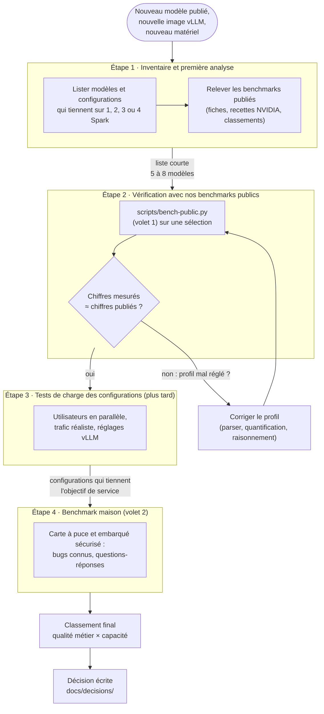
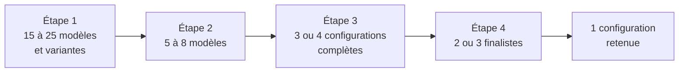
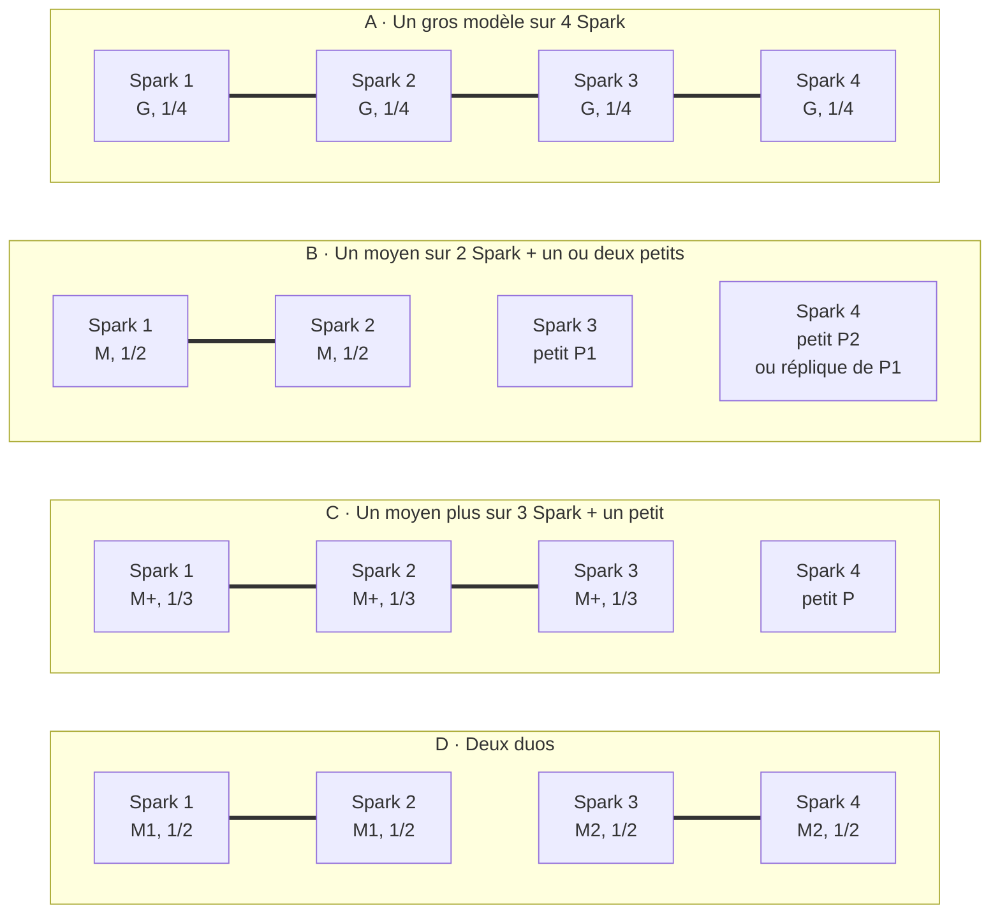
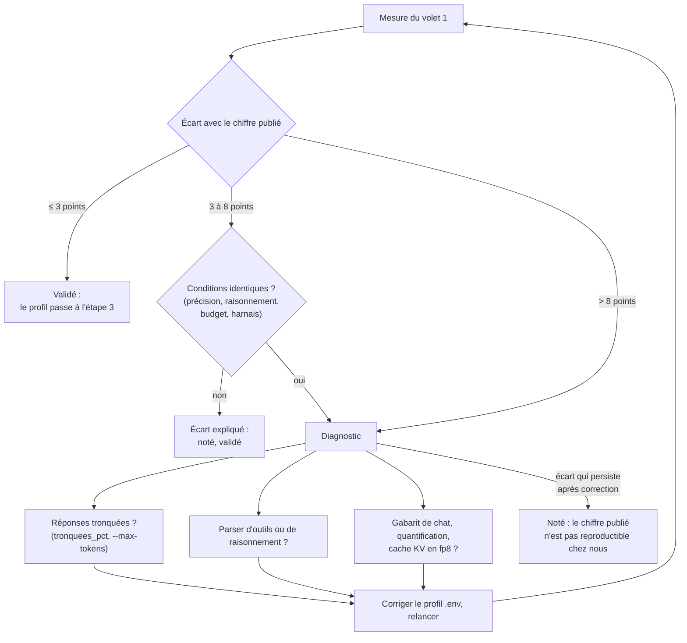
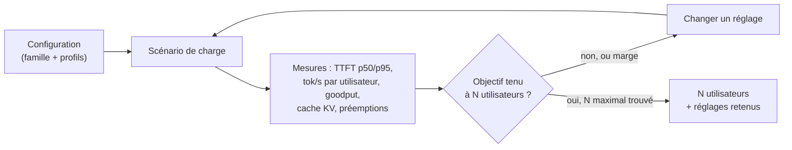
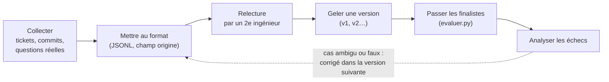

# Processus de benchmark et de classement des modèles

> **Date** : 2026-11-17 · **Auteur** : Antonin · **Statut** : en cours (étapes 1, 2 et 4 à dérouler, étape 3 plus tard)

## Contexte

À terme, la plateforme tournera sur **4 DGX Spark reliés entre eux** (4 × 128 Go de mémoire unifiée). Il faut décider comment les occuper :

- **un gros modèle réparti sur les 4 Spark**, le plus capable possible, que tout le monde se partage ;
- ou **un modèle un peu moins gros** (sur 2 ou 3 Spark) **plus un ou deux petits modèles rapides** sur les Spark restants, pour les questions simples, l'autocomplétion ou absorber la charge.

Pour trancher, on note chaque **modèle** et chaque **configuration** (répartition sur les Spark, quantification, options vLLM) avec le même processus, en quatre étapes. Chaque étape est un filtre : on part large et on ne garde que ce qui mérite l'étape suivante, plus coûteuse.

Le détail technique des mesures (jeux, notation, scripts) est dans [PLAN-EVALUATION.md](../../PLAN-EVALUATION.md) (ajouté par la PR #16). Cette page explique l'enchaînement et ce que chaque étape doit produire.

## Vue d'ensemble



| Étape | Question | Coût | Ce qui sort |
|---|---|---|---|
| 1. Inventaire | Qu'est-ce qui tient sur nos Spark, et que disent les chiffres publiés ? | Lecture, quelques heures | [Tableau des candidats](candidats-modeles.md), liste courte |
| 2. Benchmarks publics | Retrouve-t-on les chiffres publiés sur notre installation ? | 1 à 3 h par modèle (rapide), une nuit (complet) | Couples modèle × configuration validés, écarts expliqués |
| 3. Charge | Combien d'utilisateurs chaque configuration tient-elle, et avec quels réglages ? | Une demi-journée à une nuit par configuration | Courbes de capacité, réglages retenus |
| 4. Benchmark maison | Lequel est le meilleur sur notre métier ? | Construction du jeu : plusieurs jours-ingénieur ; exécution : une nuit par finaliste | Score par usage, finalistes départagés |

Les étapes 2 et 3 ne demandent rien à l'équipe en dehors du temps machine. L'étape 4 demande d'écrire les cas : **on commence à construire son jeu dès maintenant, en parallèle des étapes 2 et 3**, sinon il sera le goulot d'étranglement.



Les nombres sont des ordres de grandeur : l'important est que chaque étape réduise la liste avant la suivante.

## Étape 1 : lister les modèles et les configurations

### Le budget matériel

| | Par Spark | 4 Spark |
|---|---|---|
| Mémoire unifiée | 128 Go | 512 Go |
| Réservable par vLLM sur le Spark qui porte aussi la pile (Open WebUI, RAG, LiteLLM…) | ~86 à 92 Go (mesuré en duo, `VLLM_GPU_UTIL` 0.68 à 0.74) | |
| Réservable sur un Spark qui ne fait que du vLLM | ~110 Go | |

Si la pile part sur le serveur annexe ([PR #15](https://github.com/Ameno1215/localIA/pull/15)), le Spark 1 retrouve lui aussi ~110 Go. À garder en tête : cela change ce qui tient sur 4 Spark.

Un modèle doit laisser de la place au **cache KV** (le contexte des utilisateurs en cours) : un modèle qui tient tout juste ne sert qu'un ou deux utilisateurs à la fois. Règle de départ : poids ≤ 70 % de la mémoire réservée.

### Les familles de configurations



Un trait double relie les Spark qui se partagent un même modèle. G : gros modèle (300 à 400 Go de poids) ; M : modèle moyen ; P : petit modèle rapide ; pour D, M1 et M2 sont deux modèles différents ou deux répliques du même.

| Famille | Pour | Contre | À vérifier |
|---|---|---|---|
| **A** : 1 gros sur 4 | Qualité maximale, un seul modèle à maintenir | Tous les utilisateurs dans la même file ; débit par requête limité par les liaisons entre Spark ; si un Spark tombe, plus de modèle | Câblage des 4 Spark (switch ou maillage), TP=4 ou TP=2 × PP=2 |
| **B** : moyen sur 2 + 1 ou 2 petits | Les questions simples ne bloquent pas les longues sessions OpenCode ; panne d'un Spark = service dégradé, pas coupé | Il faut router les requêtes (issues #17 et #18) ; le moyen est moins capable que le gros | Qualité du routage, part du trafic que le petit absorbe |
| **C** : moyen sur 3 + 1 petit | Plus de mémoire pour un modèle « moyen plus » ou pour son cache KV | TP=3 est rarement possible (le nombre de têtes doit être divisible) : passe par du pipeline parallel, plus lent | Que vLLM accepte la répartition sur 3 |
| **D** : deux duos | Redondance complète ou deux spécialités (code / documentation) | Deux modèles moyens au lieu d'un gros | Si deux spécialités valent mieux qu'un généraliste plus gros |

Chaque famille se décline ensuite en **variantes** : quantification (NVFP4, FP8), décodage spéculatif ou non, raisonnement activé ou non, contexte maximal. Une variante = un profil `config/modeles-spark/*.env`.

### Relever les benchmarks publiés

Pour chaque candidat, une ligne dans le [tableau des candidats](candidats-modeles.md) avec :

- taille totale et active, quantification, poids sur disque, **nombre minimal de Spark** ;
- existence d'une recette vLLM pour le DGX Spark (NVIDIA, recipes.vllm.ai, communautaire) et image nécessaire ;
- contexte maximal, appel d'outils (parser), raisonnement, vision ;
- licence ;
- débit publié (tok/s pour 1 requête sur Spark, s'il existe) ;
- **benchmarks publiés**, en priorité ceux que l'étape 2 sait refaire : MMLU-Pro, GPQA Diamond, IFEval, HumanEval+ / MBPP+, Aider polyglot, RULER, LongBench v2. On note aussi ceux qu'on ne refait pas mais qui comptent pour nous (SWE-bench Verified, LiveCodeBench, TerminalBench), sans les mettre au même niveau.

Pour chaque chiffre, on note **la source, la date et les conditions** : précision (BF16 ou quantifié), raisonnement activé ou non, budget de jetons, nombre d'essais. Sans les conditions, un chiffre publié ne sert à rien à l'étape 2. Un chiffre fourni seulement par l'éditeur et jamais reproduit est marqué « non vérifié ».

### Critères d'élimination

Un candidat sort de la liste s'il :

- ne tient sur aucune configuration avec au moins ~20 % de mémoire pour le cache KV ;
- n'a pas d'image vLLM qui tourne sur ARM64 / GB10 ;
- n'appelle pas d'outils de façon fiable (indispensable pour OpenCode et le RAG par MCP) ;
- a une licence incompatible avec un usage en entreprise ;
- est nettement en dessous des autres de sa taille sur les benchmarks de code et d'agent publiés.

**Livrable** : le tableau rempli, et une liste courte de 5 à 8 modèles pour l'étape 2, avec au moins un candidat par rôle (gros, moyen, petit).

## Étape 2 : vérifier les chiffres publiés avec nos benchmarks publics

But : s'assurer que **notre installation** (quantification, image vLLM, parser d'outils, raisonnement, duo) donne bien les performances annoncées. Un écart important désigne presque toujours un profil mal réglé plutôt qu'un mauvais modèle. Cette étape ne classe pas encore les modèles sur notre métier.

L'outil existe : `scripts/bench-public.py` (volet 1, PR #16, détaillé au § 2 de [PLAN-EVALUATION.md](../../PLAN-EVALUATION.md)).

```bash
./scripts/bench-public.py preparer                          # une fois, avec Internet
./scripts/modeles.py utiliser <profil>                      # charger le candidat
./scripts/bench-public.py lancer --note "étape 2"           # préréglage rapide, 1 à 3 h
./scripts/bench-public.py lancer --preset complet           # pour les modèles retenus, une nuit
./scripts/rapport-modeles.py                                # tableau comparatif
```

### Comparer mesuré et publié

Pour chaque benchmark mesuré qui a un équivalent publié :

| Benchmark | Publié | Conditions publiées | Mesuré | Écart | Verdict |
|---|---|---|---|---|---|
| _ex. GPQA Diamond_ | _91,5 %_ | _NVFP4, raisonnement, recette NVIDIA_ | | | |



Les seuils (3 et 8 points) sont un point de départ, à ajuster quand on connaîtra la variabilité réelle : `rapport-modeles.py` donne l'écart-type dès deux exécutions, et un écart plus petit que cet écart-type n'est pas un écart.

À ne pas oublier :

- les jeux publics sont en anglais, surtout en Python, et certains ont été vus à l'entraînement : ils détectent un profil cassé, ils ne départagent pas deux bons modèles ;
- on compare aussi le **débit** mesuré (tok/s pour 1 requête) au débit des recettes NVIDIA : un débit bien plus bas signale le plus souvent un décodage spéculatif inactif ou une image différente ;
- on teste chaque modèle **avec et sans raisonnement** (`--sans-raisonnement`) : c'est souvent là que le choix se joue entre qualité et latence.

**Livrable** : une note datée dans [docs/notes/](../notes/) par série de mesures (profils, écarts, corrections faites), et la liste des couples modèle × configuration validés.

## Étape 3 : tester les configurations sous charge (plus tard)

But : savoir **combien d'utilisateurs simultanés** chaque configuration complète tient, et **comment la régler**. C'est ici que les familles A, B, C et D se comparent vraiment : un modèle plus capable qui ne tient que 3 utilisateurs n'est pas le bon choix pour l'équipe.

Cette étape sera faite plus tard, quand les 4 Spark seront reliés. Ce qui existe déjà : la famille `charge` du volet 1 (`vllm bench serve` à tailles fixes) et Prometheus pour les métriques vLLM et GPU (issue #8). Ce qu'il faudra ajouter est décrit au § 5 de [PLAN-EVALUATION.md](../../PLAN-EVALUATION.md).

### Ce qu'on fait varier

| Réglage | Effet |
|---|---|
| `VLLM_MAX_SEQS` (requêtes traitées en même temps) | Plus d'utilisateurs servis, moins de tok/s chacun |
| `VLLM_GPU_UTIL`, contexte maximal, cache KV fp8 | Place pour le cache KV, donc nombre de longues sessions simultanées |
| `--max-num-batched-tokens`, chunked prefill | Équilibre entre premier jeton rapide et débit |
| Décodage spéculatif (MTP, DFlash…) | Gain en tok/s à faible charge, parfois perte à forte charge |
| Cache de préfixe | Gain quand beaucoup de requêtes partagent le même début (prompt système, même dépôt) |
| Répartition (TP, PP, répliques) et routage | Pour B, C et D : quelle part du trafic va au petit modèle |

### Les scénarios

- Concurrence fixe 1, 4, 8, 16, 32 utilisateurs, puis débit d'arrivée croissant jusqu'à saturation.
- **Trafic réaliste** : tailles de requêtes tirées des lignes LiteLLM (jamais le texte). Le cas critique est le mélange de sessions OpenCode longues (30 à 60 k jetons de contexte) et de questions courtes dans Open WebUI.
- **Pression sur le cache KV** : sessions longues ajoutées jusqu'à la première préemption.
- Pour les configurations à plusieurs modèles : le routage automatique ([issue #18](https://github.com/Ameno1215/localIA/issues/18)) et l'indicateur de charge par modèle ([issue #17](https://github.com/Ameno1215/localIA/issues/17)) sont testés ici, sous charge.

On mesure à travers LiteLLM (toute la pile, comme les utilisateurs) et directement sur vLLM (le modèle seul).

### Le résultat lisible

On fixe d'abord un **objectif de service** (décision 5 de PLAN-EVALUATION, encore ouverte), par exemple : premier jeton en moins de 3 s pour Open WebUI, en moins de 10 s pour une requête OpenCode à 50 k jetons, et au moins 15 tok/s par utilisateur. Le résultat de l'étape est alors une phrase par configuration : « **la configuration X tient N utilisateurs actifs en respectant l'objectif** », avec les réglages qui y arrivent.



**Livrable** : pour chaque configuration, sa courbe de capacité et ses réglages, dans une note de [docs/notes/](../notes/).

## Étape 4 : benchmark maison sur nos cas d'usage terrain

But : départager les finalistes **sur notre métier**, la carte à puce et l'embarqué sécurisé, là où aucun benchmark public ne dit rien. C'est l'étape qui décide. Elle correspond au volet 2 de [PLAN-EVALUATION.md](../../PLAN-EVALUATION.md) (§ 3 et 4), qui donne les règles détaillées.

### Les deux familles de cas

**Résolution de bugs connus** (§ 4.3 de PLAN-EVALUATION)

- **Vrais bugs historiques**, tirés du gestionnaire de tickets et de git : le symptôme (ticket, trace, test qui échoue) est donné au modèle, le commit de correction est la référence, les tests de non-régression jugent. Les plus représentatifs : débordements de buffer, alignement, endianness, gestion des états APDU, contre-mesures aux attaques en faute.
- **Bugs injectés** dans un module C bien testé (mutation : `<` ↔ `<=`, décalage de ±1, condition inversée, mauvais index). Beaucoup de cas sans effort humain, notés par exécution.
- On mesure : % de bugs corrigés, % de correctifs qui cassent un autre test, bonne localisation de la fonction fautive, taille du correctif.

**Questions-réponses** (§ 4.1 de PLAN-EVALUATION)

- Domaine : ISO 7816-3/4, ISO 14443, GlobalPlatform, Java Card, EMV, Critères Communs, contraintes mémoire et énergie d'une carte, sécurité du code embarqué.
- Trois formes : QCM (noté automatiquement), réponse courte avec faits attendus (regex, format de `evals/normes.jsonl`), problème ouvert avec grille de points attendus.
- 10 % de questions sans réponse ou à prémisse fausse : on attend un refus ou une correction, pas une invention.
- Sources : questions réellement posées en revue ou par un nouvel arrivant, erreurs déjà constatées chez les modèles.

### Construire le jeu



Règles qui comptent (détail au § 3 de PLAN-EVALUATION) :

- **Au moins 50 cas par famille**, idéalement 100 : en dessous, deux modèles proches ne se distinguent pas.
- Les cas tirés de notre code ou de nos documents sont **confidentiels** : ils vivent dans `WS_DIR/evals-internes/` sur le Spark, jamais dans git. Le dépôt ne garde que le format et des exemples.
- Une version gelée ne se modifie plus : on corrige dans la version suivante et on repasse les finalistes, sinon les scores ne sont plus comparables.
- La notation se fait en local : par exécution pour les bugs, par correspondance pour les QCM et faits attendus, et par un LLM juge local **calibré sur 30 à 50 notes humaines** seulement pour les problèmes ouverts.

C'est aussi ce jeu qui débloque l'[issue #12](https://github.com/Ameno1215/localIA/issues/12) (questions de référence réelles pour l'évaluation fixe par profil).

**Livrable** : un score par famille et par finaliste, avec intervalle de confiance, dans `rapport-modeles.py`.

## Classement final

Les étapes 1 et 2 sont **éliminatoires** : un candidat qui ne tient pas sur nos Spark ou dont le profil ne reproduit pas les chiffres publiés ne va pas plus loin. Les étapes 3 et 4 donnent la **note**.

Grille proposée comme point de départ, à trancher :

| Critère | Vient de | Poids proposé |
|---|---|---|
| Qualité sur nos bugs | Étape 4 | 30 % |
| Qualité sur nos questions-réponses | Étape 4 | 25 % |
| Capacité : utilisateurs tenus avec l'objectif de service | Étape 3 | 25 % |
| Vitesse ressentie : tok/s et premier jeton à 1 utilisateur | Étapes 2 et 3 | 10 % |
| Exploitation : stabilité, image officielle ou communautaire, licence, nombre de modèles à maintenir | Étapes 1 et 3 | 10 % |

Pour les configurations à plusieurs modèles (B, C, D), la qualité est celle **du système** : les requêtes passent par le routage, donc la note de l'étape 4 se mesure à travers LiteLLM avec le modèle « auto », pas modèle par modèle.

Entre deux finalistes trop proches, on termine par une **revue humaine à l'aveugle** : le mode Arena d'Open WebUI (deux réponses anonymes côte à côte, vote de l'équipe).

Le choix final s'écrit dans [docs/decisions/](../decisions/), avec le tableau des scores et le lien vers les notes de mesure.

## Quand refaire le processus

| Événement | On reprend à |
|---|---|
| Nouveau modèle publié qui tient sur nos Spark | Étape 1 (une ligne au tableau), puis étape 2 s'il est prometteur |
| Nouvelle image vLLM ou nouvelle quantification d'un modèle retenu | Étape 2 (préréglage rapide) pour vérifier qu'il n'a pas régressé |
| Changement de matériel (passage à 4 Spark, serveur annexe) | Étape 1 pour les configurations, puis étape 3 |
| Nouvelle version du jeu maison | Étape 4 pour les finalistes en cours |

Le journal des profils (issue #7) et le rapport par profil (issue #11) gardent l'historique : chaque exécution est datée et rattachée à son installation, pour suivre l'évolution dans le temps.

## Ce qu'on en retient

- Quatre étapes en entonnoir : inventaire et chiffres publiés, vérification sur notre installation, charge, benchmark métier. Les deux premières filtrent, les deux dernières notent.
- L'étape 4 décide, et c'est la plus longue à préparer : on commence à écrire les cas de bugs et de questions-réponses tout de suite.
- À trancher : objectif de service (étape 3), qui écrit les cas et quel matériel interne on peut utiliser (étape 4), poids de la grille finale, câblage des 4 Spark.

## Liens

- [PLAN-EVALUATION.md](../../PLAN-EVALUATION.md) et `scripts/bench-public.py` : [PR #16](https://github.com/Ameno1215/localIA/pull/16) (volet 1 implémenté, volet 2 planifié)
- [Tableau des candidats](candidats-modeles.md) (étape 1)
- Observabilité : [issue #6](https://github.com/Ameno1215/localIA/issues/6) et ses sous-issues #7 (journal des profils), #8 (Prometheus, GPU), #9 (journal RAG), #10, #11 (rapport par profil), #12 (jeu d'évaluation)
- Charge et routage : [issue #17](https://github.com/Ameno1215/localIA/issues/17) (indicateur de charge par modèle), [issue #18](https://github.com/Ameno1215/localIA/issues/18) (modèle « auto » selon la difficulté)
- Serveur annexe : [PR #15](https://github.com/Ameno1215/localIA/pull/15)
- Installation actuelle en duo : [SPARK-DUO.md](../../SPARK-DUO.md), [vue d'ensemble](../architecture/vue-ensemble.md)
