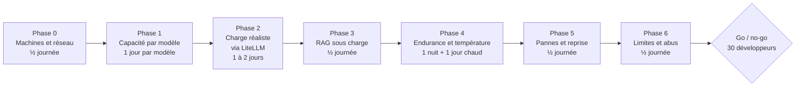

# Plan de tests de charge et de limites : 4 DGX Spark (vLLM + LiteLLM + OpenCode)

> **Date** : 2026-11-09 (plan d'origine), ajouté au dépôt le 2026-11-20 · **Auteur** : Tim · **Statut** : à jour, à dérouler à l'étape 3

Détail de l'**étape 3** du [processus de benchmark](benchmark-modeles.md). Traduction du plan de Tim ; les chiffres tirés de mesures publiées gardent leur source (liens en bas de page).

## Contexte

Le but est de trouver, pour chaque modèle et pour l'ensemble des 4 Spark, la charge à partir de laquelle les développeurs commencent à la sentir, **avant qu'ils ne la sentent**. Avec 30 utilisateurs d'OpenCode, la première limite atteinte n'est presque jamais le débit brut en jetons par seconde. Dans l'ordre, on bute d'abord sur la **capacité du cache KV** avec les longs contextes d'agent, puis sur la **température** pendant les longues exécutions, puis sur **un utilisateur dont l'essaim d'agents affame les autres**.

Le plan suppose une répartition de type B (voir [familles de configurations](benchmark-modeles.md#les-familles-de-configurations)) avec trois rôles exposés par LiteLLM :

| Rôle | Exemple de modèle | Où |
|---|---|---|
| `code-agent` | Gros modèle d'agent en TP=2 (DeepSeek-V4-Flash dans les exemples) | Spark 1 et 2 |
| `fast` | Qwen3.6-35B-A3B | Spark 3 |
| `vision` | Qwen3.8-27B, plus les embeddings et le reranker du RAG | Spark 4 |

Les phases s'appliquent aussi aux autres familles : il suffit de remplacer les rôles par ceux de la configuration testée.

## Objectifs de service proposés

À utiliser au départ, puis à ajuster après une semaine d'usage réel.

| Mesure | Cible (p95) | Pourquoi |
|---|---|---|
| Premier jeton (TTFT), préfixe en cache (tour suivant) | < 3 s | OpenCode renvoie toute la conversation ; avec le cache de préfixe, seule la partie nouvelle est pré-remplie |
| Premier jeton, prompt froid de 64 k jetons | < 45 s | Premier tour sur un gros dépôt ou un extrait de datasheet ; le pré-remplissage va de ~1 900 à 6 000 jetons/s selon le modèle |
| Vitesse de génération par requête (TPOT) | ≥ 20 tok/s sur `code-agent`, ≥ 50 tok/s sur `fast` | En dessous de ~20 tok/s, une boucle d'agent de plus de 20 étapes devient pénible |
| Latence entre jetons (ITL) p99 | < 150 ms | Les pics révèlent préemptions et blocages de l'ordonnanceur |
| Taux d'erreur | < 0,5 % | Délais dépassés, 429, manques de mémoire et appels d'outils mal formés compris |
| Temps d'attente en file | ≈ 0 la plupart de la journée | Une file qui ne se vide pas = modèle saturé |

Hypothèse de charge : 10 à 15 sessions d'agent actives en même temps un jour normal, plus de 30 aux pics (les sous-agents peuvent doubler ce nombre). Les tests ci-dessous sont dimensionnés pour cela.

## Les limites, couche par couche

Chaque couche a un ou deux indicateurs qui disent qu'elle approche de sa limite. Ce sont eux qu'on surveille, **pas l'utilisation CPU ou GPU**, qui est proche de 100 % sur un serveur d'inférence en bonne santé.

| Couche | Ce qui s'épuise | Indicateur | Signal d'alerte |
|---|---|---|---|
| vLLM : cache KV | Place pour les longs contextes simultanés | `vllm:kv_cache_usage_perc`, `rate(vllm:num_preemptions_total)` | Usage > 0,90 en continu, ou la moindre préemption en charge normale |
| vLLM : ordonnanceur | Séquences simultanées, calcul | `vllm:num_requests_waiting`, `vllm:request_queue_time_seconds` | Requêtes en attente pendant plus de quelques minutes ; attente p95 > 1 s |
| vLLM : latence | Vitesse par requête quand on groupe | `vllm:time_to_first_token_seconds`, `vllm:inter_token_latency_seconds`, `vllm:e2e_request_latency_seconds` | TPOT p95 sous l'objectif ; pics d'ITL p99 |
| vLLM : cache de préfixe | Pré-remplissage économisé | `vllm:prefix_cache_hits_total` / `vllm:prefix_cache_queries_total` | Taux < 50 % sur le trafic OpenCode (il devrait être élevé : prompt système et historique se répètent) |
| vLLM : décodage spéculatif | Acceptation des jetons proposés | `vllm:spec_decode_num_accepted_tokens_total` rapporté aux jetons proposés | Acceptation qui baisse sous charge ; la spéculation peut coûter à fort groupement |
| Longueur de contexte | `--max-model-len` | Erreurs 400 « maximum context length » dans les journaux LiteLLM | La moindre, en dehors du compactage d'OpenCode |
| Mémoire unifiée | 128 Go partagés entre CPU, GPU et cache de pages | `free -g` / `MemAvailable`, entrées en swap, journaux de l'OOM-killer (pas `nvidia-smi`, qui affiche « Not Supported » ou des valeurs trompeuses sur GB10) | `MemAvailable` < 5 Go ; toute activité de swap |
| Température et puissance | Fréquence tenue dans la durée | Fréquence SM sous charge, puissance, zones thermiques ACPI dans `/sys/class/thermal` | Fréquence < 1 400 MHz sous charge ; zone ACPI > 90 °C ; `nvidia-smi` peut sous-estimer de 8 à 15 °C |
| Réseau (paires en TP) | Débit et latence RoCE | Bande passante NCCL `all_reduce_perf`, compteurs pause/drop de `ethtool -S`, MTU | Débit très en dessous du lien ; drops ou pauses PFC qui montent pendant la charge |
| LiteLLM | Workers du proxy, Postgres, limites de débit | `litellm_overhead_latency_metric` ou en-tête `x-litellm-overhead-duration-ms`, `litellm_proxy_failed_requests_metric`, `litellm_deployment_cooled_down` | Surcoût p95 > 50 ms ; la moindre requête en échec ; déploiements mis en pause |
| Équité entre utilisateurs | Essaim d'agents d'un seul développeur | Requêtes en cours par clé virtuelle | Une clé qui occupe plus de 30 % des places d'un modèle |
| RAG | Latence d'embedding, de rerank et de recherche vectorielle | p95 de `/v1/embeddings` et `/rerank`, p95 des requêtes à la base vectorielle | Rerank p95 > 500 ms pour 50 candidats ; recherche p95 > 200 ms |
| Stockage | Temps de chargement du modèle après un redémarrage | Temps entre `vllm serve` et « prêt » | Plusieurs minutes (560 s vus sur NFS) = longue coupure à chaque plantage |

## Le cache KV : le premier mur

C'est la réserve de cache KV, pas le débit, qui plafonne le nombre de sessions OpenCode qu'un modèle tient en même temps. Par exemple, à 64 k jetons par session, DeepSeek-V4-Flash sur 2 Spark en tient environ 17 avant que vLLM ne commence à préempter.

Règle de calcul : **sessions simultanées ≈ réserve KV (en jetons) ÷ contexte moyen par session**. vLLM affiche la réserve au démarrage (`GPU KV cache size: N tokens` et `Maximum concurrency for X tokens per request`) : la lire là, avec ses propres options.

| Modèle et répartition | Réserve KV (mesures publiées) | Sessions à 32 k | à 64 k | à 128 k |
|---|---|---|---|---|
| [DeepSeek-V4-Flash, 2 Spark TP=2, KV FP8](https://github.com/elsung/dgx-spark-deepseek-v4-flash) | ~1,1 M jetons | ~34 | ~17 | ~8 |
| [Qwen3.8-Flash-Next, 2 Spark SGLang TP=2](https://huggingface.co/pocharlies/Qwen3.8-Flash-Next) | 0,37 à 1,37 M jetons selon la fraction de mémoire | 11 à 42 | 6 à 21 | 3 à 10 |
| [Qwen3.8-Flash-Next, 1 Spark vLLM](https://github.com/blazux/qwen3.8-Flash-DGX/wiki) | ~0,58 à 0,63 M jetons | ~18 | ~9 | ~4 |
| [GLM-5.3-Flash, 4 Spark TP=4](https://huggingface.co/LibertAIDAI/GLM-5.3-Flash-NVFP4/discussions/5) | ~6,3 M jetons | ~190 | ~95 | ~48 |

Ce qu'on en fait :

- Mesurer le vrai contexte moyen dans les journaux LiteLLM après une semaine (jetons de prompt par requête sur `code-agent`). Les sessions OpenCode sur des dépôts de firmware tournent souvent entre 30 et 80 k.
- Le cache de préfixe partage les blocs identiques (prompt système, définitions d'outils) : la capacité réelle est un peu supérieure à la division ci-dessus.
- Si la réserve est trop petite : `--kv-cache-dtype fp8`, monter `--gpu-memory-utilization` avec prudence (la mémoire unifiée est partagée avec le système), plafonner `--max-model-len` à ce dont OpenCode a vraiment besoin, et limiter le nombre de requêtes parallèles par clé dans LiteLLM.

## Les phases de test

Dérouler les phases dans l'ordre : chacune élimine une cause d'erreur pour la suivante. Ainsi, un problème de latence en phase 2 ne peut pas venir d'un mauvais câble ou d'un Spark qui chauffe.



### Phase 0 : machines et réseau (une demi-journée)

Chaque Spark doit tenir sa fréquence sous charge, et chaque lien entre Spark d'un même modèle doit donner un débit stable, sans pertes.

```bash
# Fréquence, puissance, raisons de bridage toutes les 2 s (journaliser sur une autre machine)
nvidia-smi --query-gpu=timestamp,clocks.current.sm,power.draw,temperature.gpu,clocks_throttle_reasons.active --format=csv -l 2
# Vraies températures : les zones ACPI lisent 8 à 15 °C de plus que nvidia-smi sur certaines unités
watch -n 2 'cat /sys/class/thermal/thermal_zone*/temp'

# Trames jumbo de bout en bout (9000 de MTU moins les en-têtes)
ping -M do -s 8972 <ip-roce-du-pair>

# Débit RoCE entre chaque paire (perftest)
ib_write_bw -d <dev-rdma> --report_gbits              # sur le Spark A
ib_write_bw -d <dev-rdma> --report_gbits <ip-spark-A> # sur le Spark B

# Bande passante des collectives NCCL sur 2 puis 4 Spark (nccl-tests)
mpirun -np 4 -H spark1,spark2,spark3,spark4 ./all_reduce_perf -b 8 -e 4G -f 2 -g 1

# Pertes et trames de pause avant et après l'essai
ethtool -S <interface-roce> | grep -Ei 'drop|discard|pause'
```

### Phase 1 : capacité de chaque modèle seul (1 jour par modèle)

Attaquer chaque serveur vLLM directement (sans LiteLLM) et monter la concurrence jusqu'à ce que l'objectif de service casse. Le dernier palier qui tient est le **coude** de ce modèle.

```bash
for c in 1 2 4 8 16 24 32 48 64; do
  vllm bench serve --backend openai-chat --endpoint /v1/chat/completions \
    --base-url http://spark1:8000 --model deepseek-ai/DeepSeek-V4-Flash-0731 \
    --dataset-name random --random-input-len 16000 --random-output-len 800 \
    --num-prompts $((c*8)) --max-concurrency $c --num-warmups 4 \
    --percentile-metrics ttft,tpot,itl,e2el --metric-percentiles 50,95,99 \
    --goodput ttft:3000 tpot:50 \
    --save-result --result-dir results/ds-16k --label c$c
done
```

- Recommencer avec `--random-input-len` à 4 000, 32 000 et 64 000 : les longs prompts touchent le mur du KV beaucoup plus tôt.
- Recommencer avec `--dataset-name prefix_repetition` (par exemple 30 préfixes de 12 k jetons + 2 k de suffixe) pour imiter 30 sessions OpenCode qui renvoient leur historique ; comparer le TTFT avec et sans cache de préfixe.
- `--goodput ttft:3000 tpot:50` ne compte que les requêtes qui respectent TTFT < 3 s et 20 tok/s (le TPOT est en ms par jeton). Le coude est le point où le goodput cesse de monter alors que le débit de requêtes continue de grimper.
- À chaque palier, relever `kv_cache_usage_perc`, `num_requests_waiting` et les préemptions sur `/metrics`.
- Même balayage pour `fast` (Qwen3.6-35B-A3B) et `vision` (Qwen3.8-27B).

### Phase 2 : charge réaliste mélangée, à travers LiteLLM (1 à 2 jours)

Simuler toute l'équipe à la fois, à travers la passerelle, avec des contextes d'agent qui grandissent et des temps de réflexion : c'est ce qu'OpenCode envoie vraiment.

1. Écrire un scénario Locust (ou k6) : chaque développeur virtuel déroule une session de 15 à 30 étapes d'agent, avec un contexte qui grandit de ~10 k à ~80 k jetons et 5 à 30 s de réflexion ou d'outil entre deux étapes.
2. Mélange du trafic : ~60 % `code-agent`, ~30 % `fast`, ~10 % `vision`, plus les appels d'embedding et de rerank de l'outil RAG.
3. Montée par paliers : 10 → 20 → 30 → 45 développeurs virtuels, 15 minutes par palier, chacun avec sa propre clé virtuelle LiteLLM.
4. Relever l'en-tête `x-litellm-overhead-duration-ms` de LiteLLM, les erreurs par code de statut, et les métriques vLLM de chaque Spark.
5. Puis un vrai pilote : 5 développeurs pendant une semaine, puis 15, et rejouer leur trafic journalisé (horodatage, tailles de prompt et de sortie par modèle) comme charge de référence pour les futures mises à jour.

### Phase 3 : le RAG sous charge (une demi-journée)

Vérifier que l'ingestion de documents ne ralentit pas le modèle `vision` qui partage le Spark 4, et que la recherche reste rapide pendant que la charge de la phase 2 tourne.

```bash
# Débit d'embedding
vllm bench serve --backend openai-embeddings --endpoint /v1/embeddings \
  --base-url http://spark4:8001 --model Qwen/Qwen3-Embedding-8B \
  --dataset-name random --random-input-len 512 --max-concurrency 32 --num-prompts 2000
# Latence du rerank
vllm bench serve --backend vllm-rerank --endpoint /rerank \
  --base-url http://spark4:8002 --model Qwen/Qwen3-Reranker-4B \
  --dataset-name random-rerank --max-concurrency 8
```

- Mesurer la vitesse du parseur en pages par minute sur un lot mélangé (PDF natifs, scans, grandes tables de registres).
- Ingérer en masse ~2 000 pages de datasheets pendant la phase 2 ; surveiller le TPOT de `vision` et le `MemAvailable` du Spark 4.
- Lancer le test de rappel@5 du jeu RAG (étape 4 et § 4.10 de [PLAN-EVALUATION.md](../../PLAN-EVALUATION.md)), avec et sans reranker.

Dans notre pile actuelle, les embeddings (bge-m3) et le reranker tournent dans `mcp-docs` sur le Spark 1, ou sur le serveur annexe avec la PR #15 : adapter les adresses et les modèles.

### Phase 4 : endurance et température (une nuit, puis une journée chaude)

Faire tourner la phase 2 à ~70 % du coude pendant 6 à 8 heures. Les défaillances qui apparaissent ici sont thermiques, des fuites mémoire ou une lente dérive de la latence, invisibles sur des essais courts.

- Journaliser fréquence, puissance et températures ACPI toutes les 10 s **sur une autre machine** : un Spark qui surchauffe peut couper sa propre alimentation et perdre ses journaux locaux.
- Critères de réussite : aucune fréquence sous 1 400 MHz sous charge, aucune coupure, `MemAvailable` stable, latence p95 à moins de 10 % de celle de la première heure.
- Recommencer avec la baie ou la salle dans son pire état réel (portes fermées, température d'été).

### Phase 5 : pannes et reprise (une demi-journée)

Casser une chose à la fois et chronométrer combien de temps les développeurs sont gênés.

1. Tuer vLLM sur le Spark 3 : LiteLLM doit envoyer le trafic `fast` vers son repli ; vérifier `litellm_deployment_cooled_down` et les erreurs que voit OpenCode.
2. Redémarrer le Spark 2 : le `code-agent` en TP=2 tombe entièrement ; vérifier le repli vers `fast` et mesurer le temps jusqu'à « prêt » (poids sur NVMe local, pas sur NFS).
3. Débrancher un lien 200 GbE, puis redémarrer LiteLLM et son Postgres : aucune clé perdue, aucune requête bloquée.

### Phase 6 : limites et abus (une demi-journée)

Vérifier que les requêtes mal formées ou gourmandes échouent proprement et ne dégradent jamais les autres utilisateurs.

- Un prompt au-delà de `--max-model-len` renvoie une erreur 400 propre, et OpenCode compacte au lieu de planter.
- Une clé qui lance 20 agents en parallèle reçoit des 429 de LiteLLM (`max_parallel_requests`, `tpm_limit`, `rpm_limit` par clé) pendant que le TPOT des autres reste dans l'objectif.
- Une requête sans `max_tokens` est plafonnée par une valeur par défaut côté serveur.
- Compter les appels d'outils mal formés à forte charge : un `--tool-call-parser` faux ou absent se voit ici en premier.

## Go / no-go avant d'ouvrir aux 30 développeurs

On n'ouvre à toute l'équipe que lorsque chaque ligne passe au niveau de 30 développeurs virtuels de la phase 2.

| Vérification | Réussite | Phase |
|---|---|---|
| Bande passante NCCL stable sur 3 essais, zéro perte RoCE | À 5 % près d'un essai à l'autre | 0 |
| Coude de `code-agent` | ≥ 15 sessions simultanées à 32 k de contexte avec TPOT p95 ≥ 20 tok/s | 1 |
| Coude de `fast` | ≥ 30 requêtes simultanées avec TPOT p95 ≥ 50 tok/s | 1 |
| TTFT p95 préfixe en cache (tour suivant) | < 3 s | 1 et 2 |
| Préemptions à 30 développeurs virtuels | 0 | 2 |
| Surcoût LiteLLM p95 | < 50 ms | 2 |
| Taux d'erreur (toutes causes) | < 0,5 % | 2 |
| Rerank p95 (50 candidats) / recherche vectorielle p95 | < 500 ms / < 200 ms | 3 |
| Rappel@5 du RAG avec reranker | ≥ 85 % sur nos 30 questions | 3 |
| Endurance de 8 h | Aucune coupure, fréquence ≥ 1 400 MHz, dérive de latence < 10 % | 4 |
| Reprise après redémarrage d'un Spark | Le repli fonctionne ; modèle de retour en moins de 10 min | 5 |
| Clé gourmande | Reçoit des 429 ; les autres restent dans l'objectif | 6 |

## Que régler quand une limite est atteinte

Corriger la cause que l'indicateur désigne. Ajouter des Spark ou changer de modèle vient en dernier.

| Symptôme | Cause probable | Premiers réglages |
|---|---|---|
| Préemptions, usage KV > 0,9 | Réserve KV trop petite pour les contextes | `--kv-cache-dtype fp8` ; baisser `--max-model-len` ; monter `--gpu-memory-utilization` par petits pas ; limite de parallélisme par clé |
| Requêtes en attente, TTFT qui monte | Trop de séquences, ou longs pré-remplissages qui bloquent la génération | Régler `--max-num-seqs` et `--max-num-batched-tokens` ; garder le chunked prefill ; envoyer les tâches courtes vers `fast` |
| TTFT élevé à chaque tour | Le cache de préfixe ne sert pas | `--enable-prefix-caching` ; vérifier que le prompt système d'OpenCode est stable (pas d'horodatage) ; envoyer une session toujours sur la même réplique |
| TPOT qui chute à forte concurrence | Le décodage spéculatif gaspille du calcul | Moins de jetons spéculatifs (2 au lieu de 4), ou spéculation coupée au-delà d'un seuil de charge |
| Débit qui chute après 30 à 60 min | Bridage thermique ou de puissance | Circulation d'air, température de la salle ; plafonner les fréquences (`nvidia-smi -lgc`) pour échanger un peu de vitesse contre de la stabilité |
| Processus tués faute de mémoire, swap | Mémoire unifiée partagée avec le cache de pages et d'autres processus | Baisser `--gpu-memory-utilization` ; ne pas héberger de gros travaux à côté ; earlyoom ; vider les caches après le chargement des modèles |
| Modèle en TP lent, avertissements NCCL | Configuration réseau | MTU 9000 de bout en bout, classe de trafic RoCE et PFC sur le switch, `NCCL_SOCKET_IFNAME` et `UCX_NET_DEVICES` sur la bonne interface |
| Un utilisateur ralentit tout le monde | Aucune équité à la passerelle | Par clé dans LiteLLM : `max_parallel_requests`, `tpm_limit`, `rpm_limit` ; budgets par équipe |
| Appels d'outils mal formés | Mauvais parser ou mauvais gabarit de chat | `--tool-call-parser` / `--reasoning-parser` adaptés ; tester avec OpenCode avant chaque mise à jour |

## Surveillance à mettre en place

Prometheus et Grafana sont à installer **avant la phase 1** : chaque test lit les mêmes tableaux de bord que ceux qui serviront en production. Prometheus scrape déjà vLLM et les GPU depuis l'issue #8 ; ce qui suit complète.

- **vLLM** : scraper `/metrics` sur chaque port de serveur (le même que l'API) ; panneaux pour requêtes en cours et en attente, usage KV, taux de préemption, TTFT / ITL / bout en bout en p50-p95-p99, temps de file, taux de succès du cache de préfixe et acceptation du décodage spéculatif.
- **LiteLLM** : activer `callbacks: ["prometheus"]` dans `litellm_settings`, scraper `/metrics` (définir `PROMETHEUS_MULTIPROC_DIR` s'il y a plusieurs workers) ; suivre le surcoût de latence, les requêtes en échec, les mises en pause, le trafic par clé et par équipe.
- **Machines** : node-exporter pour `MemAvailable`, swap, disque et compteurs réseau ; un petit exporteur pour la fréquence et la puissance de `nvidia-smi` et les zones thermiques ACPI, ou un outil qui connaît le GB10 comme sparkview.
- **Réseau** : exporter les compteurs de drops et de pauses de `ethtool -S` de chaque interface RoCE, et les compteurs des ports du switch.
- **RAG** : histogrammes de latence sur l'outil MCP de recherche (`rechercher_docs`) et sur la base vectorielle (le journal RAG de l'issue #9 a déjà les durées).
- **Alertes** : requêtes en attente pendant 5 min, la moindre préemption, usage KV > 0,9 pendant 10 min, fréquence < 1 400 MHz sous charge, zone ACPI > 90 °C, `MemAvailable` < 5 Go, taux d'erreur LiteLLM > 1 %.

## Ce qu'on en retient

- Sur des sessions d'agent longues, c'est le cache KV qui limite d'abord : on dimensionne en sessions simultanées à 32 k et 64 k, pas en tok/s.
- Les phases s'enchaînent dans l'ordre (réseau, modèle seul, toute l'équipe, RAG, endurance, pannes, abus) et se terminent par une grille go / no-go.
- Le résultat de chaque phase alimente le critère « capacité » du [classement final](benchmark-modeles.md#classement-final).

## Sources

- [Référence des métriques vLLM](https://docs.vllm.ai/en/v0.32.0/usage/metrics/)
- [Conception des métriques vLLM (v1)](https://docs.vllm.ai/en/v0.12.0/design/metrics/)
- [CLI vllm bench serve](https://docs.vllm.ai/cli/bench/serve.html)
- [Panneaux de tableau de bord Grafana pour vLLM : SigNoz](https://signoz.io/docs/dashboards/dashboard-templates/vllm-dashboard/)
- [Métriques Prometheus de LiteLLM](https://litellm.vercel.app/docs/proxy/prometheus)
- [Benchmarks de LiteLLM et en-tête de surcoût](https://litellm.vercel.app/docs/benchmarks)
- [Coupure thermique du GB10, températures ACPI et nvidia-smi : AI Muninn](https://ai-muninn.com/en/blog/gx10-thermal-hard-poweroff)
- [Problèmes de puissance et de température du DGX Spark : AI Muninn](https://ai-muninn.com/en/blog/dgx-spark-30w-power-safety-mode)
- [sparkview, moniteur qui connaît le GB10 : GitHub](https://github.com/parallelArchitect/sparkview)
- [Mémoire unifiée et exploitation thermique du Spark](https://claudeskills.info/skills/wshobson/agents/spark-memory-thermal-ops/)
- [DeepSeek-V4-Flash sur 2 Spark, réserve KV : GitHub elsung](https://github.com/elsung/dgx-spark-deepseek-v4-flash)
- [Qwen3.8-Flash-Next sur 2 Spark, réserve KV selon la fraction de mémoire](https://huggingface.co/pocharlies/Qwen3.8-Flash-Next)
- [Qwen3.8-Flash-Next sur 1 Spark : GitHub blazux](https://github.com/blazux/qwen3.8-Flash-DGX/wiki)
- [GLM-5.3-Flash en TP4 sur 4 Spark, KV et temps de chargement](https://huggingface.co/LibertAIDAI/GLM-5.3-Flash-NVFP4/discussions/5)
